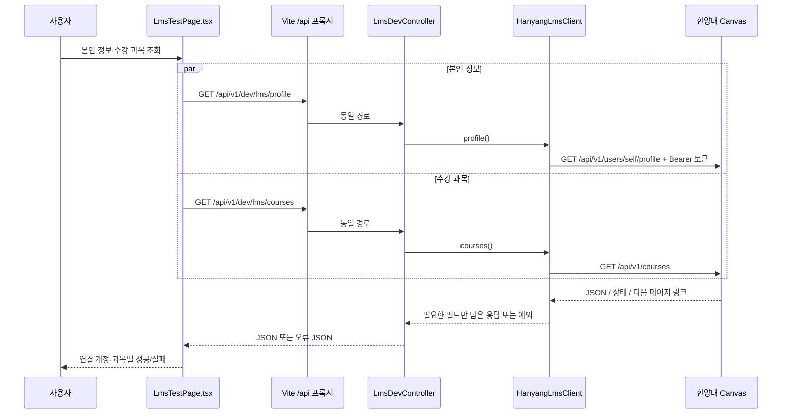

# 한양대 LMS 연동 (과목알림·LMS 테스트)

## 한양대 LMS 조회 테스트

### 확인할 수 있는 것

- 본인 계정 정보와 활성 수강 과목 목록.
- 과목명·코드·강의계획 원본 HTML·공개 설명·과목 시간대.
- 기간별 과목 공지의 제목·원문 HTML·게시 시각·원문 링크.
- 과제 이름·설명·마감·제출 가능 시작·제출 차단·제출 방식·배점.
- 주차별 학습 모듈과 모듈 내부 항목의 제목·종류·원문 링크.
- 각 API의 오류, 빈 목록, 페이지 상한으로 일부만 조회된 상태.

자동 검사는 로컬 가상 LMS를 사용합니다. 실제 한양대 계정의 과목·공지·과제 반환은 아직 미검증입니다.
검증 범위는 아래 [검증 기록](#lms-연동-검증-기록), 동작 원리는 [코드 설명](#lms-테스트-페이지의-코드와-동작)을 참고하세요.

### 1. backend/.env 설정

저장소의 `backend/`에서 `.env`가 없는 첫 설정에만 실행합니다.

```bash
cp -n .env.example .env
```

`.env`가 이미 있다면 복사하지 말고 해당 파일을 편집합니다.

```dotenv
SERVER_PORT=8081
LMS_API_BASE_URL=https://learning.hanyang.ac.kr/api/v1
LMS_API_TOKEN=여기에_한양대_LMS_개인_액세스_토큰
```

- 일반 한양대 Open API 개발자센터의 키와 LMS 개인 토큰은 다릅니다.
- 값에 따옴표·`export`를 붙이지 않습니다. 프론트 `.env`나 `VITE_*`에는 토큰을 넣지 않습니다.
- Spring Boot는 실행 디렉터리의 `.env`를 읽습니다. IDE의 작업 디렉터리를 `backend/`로 맞춥니다.
- 수정한 값은 백엔드 재시작 후 반영됩니다. 브라우저 새로고침만으로는 서버 토큰이 바뀌지 않습니다.
- OS/IDE 환경변수는 `.env`보다 우선할 수 있습니다. 이전 `LMS_API_TOKEN`이 설정되어 있다면 확인하세요.
- `.env`는 `.gitignore`로 제외됩니다. 토큰을 채팅에 공유할 필요가 없습니다.

### 2. 서버 실행

백엔드는 Java 21, 프론트는 Node 24를 사용합니다.

```bash
# 터미널 A: 저장소의 backend/ 폴더에서
# macOS 기본 Java가 17이면 먼저 JDK 21로 전환
export JAVA_HOME=$(/usr/libexec/java_home -v 21)
./mvnw spring-boot:run
```

```bash
# 터미널 B: 저장소의 frontend/ 폴더에서
npm ci
npm run dev
```

[테스트 페이지](http://127.0.0.1:5173/lms-test)를 엽니다. 하단 LMS 메뉴로도 이동할 수 있습니다.
이미 서버가 실행 중이면 같은 포트로 중복 실행하지 마세요. 토큰 변경 시 기존 백엔드를 종료하고 다시 실행합니다.

### 3. 화면에서 확인

로컬 기본 개발 프로필에서는 데모 암호를 비워도 됩니다. Render 배포의 공통 계정 데모는
발표자가 정한 데모 암호가 필요합니다. 실제 Canvas 토큰을 화면에 입력하지 않습니다.
배포 설정은 [배포 문서](../deployment.md#공통-계정-lms-데모)를 참고하세요.

1. ‘데모 계정·수강 과목 조회’를 누릅니다.
2. 계정 이름과 실제 수강 과목이 일치하는지 확인합니다.
3. 과목과 공지 시작/종료일을 선택합니다.
4. ‘선택 과목의 설명·공지·과제·학습 목록 조회’를 누릅니다.
5. 과목 설명, 공지, 과제 마감과 제출 방식, 학습 모듈을 확인합니다.
6. 모듈의 ‘학습 항목 조회’를 눌러 자료·과제 등의 제목과 종류를 확인합니다.
7. 실제 LMS 화면과 제목·본문·날짜·시간을 대조하고 [검증 기록](#lms-연동-검증-기록)의 실환경 표를 채웁니다.

각 영역은 따로 성공/실패를 표시합니다. 과제 요청 실패가 공지 결과를 숨기지 않습니다.
과목을 바꾸면 이전 과목의 결과는 지웁니다. 공지 기간을 바꾸면 기존 공지 결과도 지웁니다.

### 4. 날짜와 내용 해석

- 공지 기간은 공지에만 적용됩니다. 과제는 페이지 상한 내 전체 반환 목록을 조회합니다.
- `due_at`: 과제 제출 마감. `unlock_at`: 제출 가능 시작. `lock_at`: 제출 차단. 서로 대체하지 않습니다.
- `override_assignment_dates=true`로 조회 계정에 적용되는 기한을 요청합니다. 개인 연장·분반별 기한은 본인의 LMS와 대조합니다.
- 날짜는 한국 시간과 API 원본을 함께 표시합니다. `2026-10-25T14:59:00Z`는 한국 시간 10/25 23:59입니다.
- 날짜 `null`은 ‘API에 날짜가 제공되지 않음’입니다. 마감 없음으로 확정하거나 임의로 23:59를 만들지 않습니다.
- 공지의 `posted_at`는 게시 시각이며 제출 마감이 아닙니다. 이 검사 화면은 공지 본문 속 마감을 추출하지 않습니다. 제품 과목알림은 `AnnouncementDeadlines`로 공지 본문의 마감을 규칙 기반으로 추출합니다.
- 강의계획·공지·과제의 HTML은 실행하지 않고 텍스트로 표시합니다. 원문 링크에서 실제 LMS와 대조할 수 있습니다.
- 모듈 조회는 항목 목록을 확인합니다. 파일 본문·동영상·페이지 본문을 자동 다운로드하지 않습니다.
- 빈 목록은 해당 기간/권한에서 반환된 항목이 없다는 의미입니다. API 미지원으로 곧바로 단정하지 않습니다.
- LMS 화면 일부가 LearningX 등 외부 도구라면 Canvas 모듈/과제 API와 일치하지 않을 수 있습니다. 차이를 기록합니다.

### 5. API 직접 검사

요청은 로컬 백엔드로 보내며 토큰 헤더를 직접 넣지 않습니다. 42와 8은 실제 반환 ID로 바꿉니다.

```bash
curl http://127.0.0.1:8081/api/v1/dev/lms/profile
curl http://127.0.0.1:8081/api/v1/dev/lms/courses
curl http://127.0.0.1:8081/api/v1/dev/lms/courses/42
curl http://127.0.0.1:8081/api/v1/dev/lms/courses/42/assignments
curl http://127.0.0.1:8081/api/v1/dev/lms/courses/42/modules
curl http://127.0.0.1:8081/api/v1/dev/lms/courses/42/modules/8/items
```

공지 예시:

```bash
curl --get http://127.0.0.1:8081/api/v1/dev/lms/announcements \
  --data-urlencode 'courseId=42' \
  --data-urlencode 'startDate=2026-10-01' \
  --data-urlencode 'endDate=2026-10-24'
```

공지 날짜를 생략하면 한국 시간 기준 최근 90일부터 오늘까지 조회합니다. 기간은 최대 366일이며 ID는 양수여야 합니다.
목록은 페이지당 50건·최대 5페이지로 제한하며 `truncated=true`면 일부 결과입니다.

### 6. 오류 확인

| 코드 | 확인할 것 |
| --- | --- |
| LMS_NOT_CONFIGURED | backend/.env 위치·키 이름·백엔드 재시작 |
| LMS_INVALID_TOKEN_FORMAT | 토큰 안의 공백·줄바꿈 |
| LMS_TOKEN_REJECTED | LMS 401. 발급 위치·만료·토큰 값 |
| LMS_PERMISSION_DENIED | LMS 403. 과목/기능 열람 권한 |
| LMS_RESOURCE_NOT_FOUND | LMS 404. API 주소·과목/모듈 ID |
| LMS_RATE_LIMITED | LMS 429. 잠시 후 재시도 |
| LMS_REDIRECT_BLOCKED | 실제 API 주소 확인 |
| LMS_CONNECTION_FAILED | 연결·인증서·타임아웃 |
| LMS_INVALID_RESPONSE | 예상 JSON 필드와 실제 응답 차이 |
| LMS_UNSAFE_PAGINATION | 다른 주소·경로 또는 반복된 다음 페이지 |

화면은 오류 코드, 로컬 서버 HTTP 상태, 있으면 상위 LMS HTTP 상태를 표시합니다.
예를 들어 토큰 거부는 `LMS_TOKEN_REJECTED · 서버 HTTP 502 · LMS HTTP 401`입니다.
LMS의 원본 오류 본문이나 인증 헤더는 반환하지 않습니다.

### 범위

`/api/v1/dev/lms/*`는 한 명의 서버 설정 토큰을 사용하는 개발 검사 API입니다.
`prod` 프로필에서는 비활성화됩니다. 실제 다중 사용자 서비스에는 로그인·개인별 연동·권한 검사가 추가로 필요합니다.
학교 본부·국제처·단과대 공개 게시판 수집은 `integrations/school`의 별도 작업입니다.

## LMS 테스트 페이지의 코드와 동작

### 목적과 범위

`backend/.env`에 본인 LMS 토큰을 설정했을 때 실제 과목·공지·과제·마감·학습 목록이 반환되는지
확인하는 읽기 전용 개발 도구다. 실제 토큰 테스트는 사용자가 수행해야 하며, 가상 API 테스트와 구분한다.
DB 저장·공지 AI 분석·번역·서비스 로그인은 이 검사 도구의 범위에 포함하지 않는다.

### 파일별 책임

| 파일 | 역할 |
| --- | --- |
| `backend/src/main/resources/application.yml` | 실행 디렉터리의 `.env`를 Spring 설정에 포함. `app.lms` 설정 연결 |
| `backend/src/main/java/com/aix/team03/integrations/lms/LmsProperties.java` | API 기본 주소와 토큰을 서버 메모리에서 관리 |
| `.../LmsDevController.java` | `/api/v1/dev/lms`의 HTTP GET 요청을 받고 클라이언트 호출. `prod`에서는 비활성 |
| `.../HanyangLmsClient.java` | Canvas HTTP 요청, 토큰 헤더, ID/응답 검증, 페이지네이션, 통신 오류 변환 |
| `.../LmsModels.java` | Course·CourseDetail·Announcement·Assignment·CourseModule·ModuleItem·Page 응답 타입 |
| `backend/src/main/java/com/aix/team03/global/error/GlobalExceptionHandler.java` | LMS 예외를 안전한 HTTP 상태와 오류 JSON으로 변환 |
| `frontend/vite.config.ts` | 브라우저의 `/api` 요청을 로컬 백엔드 8081로 프록시 |
| `frontend/src/shared/api/client.ts` | 공통 fetch, JSON·HTTP 오류 처리, code/upstreamStatus 보존 |
| `frontend/src/features/lms-test/api.ts` | 각 검사 API 경로와 TypeScript 응답 타입 |
| `frontend/src/features/lms-test/LmsTestPage.tsx` | 버튼·과목/기간 입력·결과·오류·날짜 표시 |
| `backend/src/test/java/com/aix/team03/integrations/lms/HanyangLmsClientTests.java` | 로컬 가상 Canvas로 요청·응답·실패 경로 검증 |

`.../`는 `backend/src/main/java/com/aix/team03/integrations/lms/`를 뜻한다.

### 전체 요청 흐름



토큰은 브라우저 → 백엔드 요청에 실리지 않는다. 백엔드가 LMS로 요청할 때만
`Authorization: Bearer ...`를 추가한다. `LmsProperties`를 API 응답으로 반환하지 않는다.

### 버튼 1: 본인 정보·수강 과목 조회

`loadCourses()`는 과목 상세 결과를 초기화하고 다음 두 호출을 동시에 기다린다.

```ts
const [owner, list] = await Promise.allSettled([
  getLmsProfile(),
  getLmsCourses(),
])
```

한 호출의 실패로 다른 성공 결과를 잃지 않도록 `Promise.allSettled`를 사용한다.
목록이 있으면 첫 과목을 기본 선택한다. 실제 과목 선택은 API에서 받은 ID로 한다.

### 버튼 2: 선택 과목 조회

`loadCourse()`가 선택 과목의 다음 네 리소스를 요청한다.

| 화면 영역 | 로컬 API (`/api/v1/dev/lms` 뒤) | Canvas API (`/api/v1` 뒤) | 주요 파라미터 |
| --- | --- | --- | --- |
| 과목 설명 | `/courses/{id}` | `/courses/{id}` | `include[]=syllabus_body` |
| 공지 | `/announcements` | `/announcements` | `context_codes[]=course_{id}`, 시작/종료일 |
| 과제 | `/courses/{id}/assignments` | `/courses/{id}/assignments` | `override_assignment_dates=true`, `order_by=due_at` |
| 주차 목록 | `/courses/{id}/modules` | `/courses/{id}/modules` | `per_page=50` |

여기도 `Promise.allSettled`를 사용한다. 과제 API가 403이더라도 공지가 성공했으면 그대로 보여준다.
결과가 돌아올 때까지 중복 조회와 입력 변경을 막는다.
다른 과목을 고르면 이전 결과를 지워 과목과 내용이 섞이지 않게 한다.
공지 기간을 바꾸면 이전 공지 결과를 지우며, 그 기간을 과제 기한 필터로 사용하지 않는다.

### 버튼 3: 학습 항목 조회

`loadItems(module)` → `getLmsModuleItems(courseId, moduleId)` → `moduleItems()` 순서다.
Canvas의 `/courses/{courseId}/modules/{moduleId}/items?include[]=content_details`를 요청한다.
모듈에 항목이 내장될 것이라고 가정하지 않고 별도 목록 API로 조회한다.
자료·페이지·과제·외부 도구 등의 제목과 종류를 표시하며 파일/동영상 본문은 가져오지 않는다.

### 외부 요청과 페이지네이션

`HanyangLmsClient.get()`는 토큰이 비었으면 외부 요청 전에 `LMS_NOT_CONFIGURED`를 반환한다.
HTTPS를 사용하며 로컬 가상 서버에만 HTTP를 허용한다. 연결 제한 10초, 읽기 제한 15초다.
리디렉션을 따라가지 않으며 오류 원문·인증 헤더를 브라우저로 전달하지 않는다.

목록 메서드는 공통 `pages()`를 사용한다.

```text
첫 URL 요청 → JSON 목록 추가 → Link 헤더의 rel="next" 확인
  → 동일 scheme/host/port/path인지 확인 → 다음 페이지 요청
  → 다음 링크가 없거나 5페이지에 도달하면 종료
```

반환 형식은 `{ items, pagesFetched, truncated }`다.
다른 주소/경로·반복된 다음 링크는 중단한다. 상한에 도달하면 `truncated=true`를 표시한다.
필수 ID·이름 등이 없거나 목록에 null이 섞여 있으면 정상 빈 목록으로 처리하지 않고 오류로 표시한다.

### 날짜·원문·오류를 표시하는 방식

- `due_at`: 마감, `unlock_at`: 제출 시작, `lock_at`: 제출 차단. 각각 보존한다.
- `override_assignment_dates=true`는 조회 계정에 적용되는 날짜를 요청한다. 개인/분반별 차이는 실환경에서 대조한다.
- `dateLabel()`은 한국 시간과 원본 문자열을 함께 표시한다. null·잘못된 날짜는 별도 문구로 남긴다.
- `posted_at`는 공지 게시 시각이다. 과제 마감으로 사용하지 않는다.
- HTML은 React의 `<pre>{value}</pre>`로 출력하므로 HTML/스크립트로 실행되지 않는다.
- `OriginalLink`는 파싱 가능한 HTTP/HTTPS 링크만 제공한다.
- 서버는 `{ code, message, upstreamStatus }`를 반환하고 `ApiError`가 이 정보를 보존한다.
- `settled()`와 `Panel`은 성공 데이터 또는 해당 영역의 오류를 표시한다. 오류를 빈 목록으로 바꾸지 않는다.

### 이 검사로 알 수 없는 것

가상 테스트 통과만으로 한양대 운영 서버의 토큰 발급·API 권한·LearningX 호환성을 증명하지 않는다.
일반 학교 Open API 키는 LMS 토큰과 별개다. 실제 계정으로 화면과 대조한 결과를 남겨야 연동 가능성을 확정할 수 있다.
확인 순서와 해석은 [검사 방법](#한양대-lms-조회-테스트)과 [검증 기록](#lms-연동-검증-기록)을 참고한다.

공식 근거: [Courses](https://developerdocs.instructure.com/services/canvas/resources/courses),
[Announcements](https://developerdocs.instructure.com/services/canvas/resources/announcements),
[Assignments](https://developerdocs.instructure.com/services/canvas/resources/assignments),
[Modules](https://developerdocs.instructure.com/services/canvas/resources/modules).

## LMS 연동 검증 기록

기록일: 2026-10-24. 자동 검사는 가상 Canvas, 실환경 검사는 본인 한양대 계정으로 구분한다.

### 자동 검사

- Java 21의 `./mvnw verify`: 통과. 총 18개 테스트, 실패/오류 0.
- LMS 클라이언트·개발 HTTP 경로 검사 17개, Spring 애플리케이션 기동 검사 1개.
- 프론트 `npm run build`, `npm run lint`, `npm run format:check`: 통과.
- 실제 로컬 서버/프록시 경로에서 토큰 미설정 응답 확인.

주요 확인 내용:

| 항목 | 확인한 동작 |
| --- | --- |
| 인증 헤더 | 가상 서버에서 Bearer 헤더 확인. 토큰 누락 시 외부 요청 안 함 |
| 과목 | 강의계획 요청 파라미터·과목 ID 검증 |
| 공지 | 과목 코드와 명시적 조회 기간 전달 |
| 과제 | 본인 날짜 적용 요청·페이지네이션·마감/차단 분리·null 날짜 보존 |
| 학습 목록 | 모듈과 모듈 항목을 별도 API로 조회 |
| 응답 검증 | 다른 과목 ID·잘못된 필수 필드·null 목록 항목 거부 |
| 오류 | 401·403·429를 빈 목록으로 바꾸지 않음 |
| 페이지네이션 | 같은 주소/경로만 허용, 5페이지 제한·일부 조회 표시 |
| 리디렉션 | 외부 이동을 따라가며 토큰을 전달하지 않음 |

브라우저 자동 검사도 통과했다. 실제 로컬 백엔드의 토큰 미설정 오류를 확인하고,
가상 응답으로 과목/공지/과제/모듈 상세, 한국 시간 변환, 날짜 누락, HTML 비실행과 URL 필터링,
일부 API 실패 시 다른 결과 유지, 과목/기간 변경 시 이전 결과 초기화를 확인했다.
320/390/1024px 폭에서 가로 넘침이 없고 브라우저 JavaScript 실행 오류도 없었다.
브라우저의 정상 데이터 검사는 가상 응답이며 실제 학교 계정 검사가 아니다.

### 한양대 실환경 검사 — 미실행

현재 작업에서는 실제 LMS 토큰을 제공받거나 사용하지 않았다.
가상 테스트 통과는 학교 운영 API의 권한·호환성 검증을 대신하지 않는다.

| 검사 | 기록할 결과 | 현재 |
| --- | --- | --- |
| 본인 확인 | 본인 계정인지 여부, HTTP 상태 | 미실행 |
| 수강 과목 | 실제 수강 목록과 일치 여부, 반환 건수 | 미실행 |
| 과목 설명 | 코드·설명·강의계획 필드 제공 여부 | 미실행 |
| 공지 | 기간·제목·본문·게시 시각·원문 링크 대조 | 미실행 |
| 과제 | 이름·설명·제출 방식·본인 마감/차단 시각 대조 | 미실행 |
| 주차별 학습 | 모듈·항목이 실제 LMS 화면과 일치하는지 | 미실행 |
| 누락 항목 | 빈 목록·권한 거부·LearningX 등 별도 도구 차이 | 미실행 |

토큰·개인 이름·학생 ID·비공개 원문을 이 파일에 넣지 않는다.
상태·건수·필드 제공 여부와 대조 결과만 기록한다.

판정 기준:

- HTTP 200과 실제 제목·본문·날짜가 본인 LMS와 일치하면 해당 기능의 기본 연동 성공.
- HTTP 200 빈 배열은 호출 성공이지만 내용 연동은 미확인.
- 일부 기능만 성공하면 리소스별로 성공/미확인/실패를 분리.
- 실제 앱 공개 전에는 개인별 인증·권한과 학교의 허용 연동 방식을 별도로 검증.
