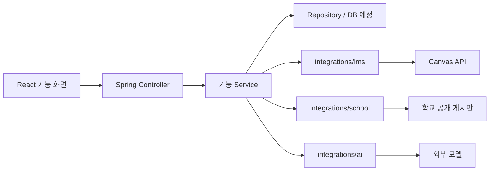

# NEST 초기 디렉터리 구성안

작성: 2026-10-24. 현재 React + Spring Boot 프로젝트를 출발점으로 한 개발 제안이다.
아래의 `(예정)` 경로는 기능 구현 시 생성하며, 구현 완료를 의미하지 않는다.

## 기준

- 프론트와 백엔드를 한 저장소에서 관리한다. 별도 AI 서버나 마이크로서비스는 지금 추가하지 않는다.
- 기능 기준으로 나누고, 각 기능 안에서 UI·API·로직·저장 책임을 분리한다.
- LMS 응답은 `integrations/lms`에 둔다. 제품의 공지·과제 데이터 모델과 그대로 공유하지 않는다.
- `lms-test`와 `/api/v1/dev/lms`는 개발 검사 도구다. 제품용 로그인·개인별 연동을 대신하지 않는다.
- 학교 전체 공지와 수강 과목 공지를 구분한다. 수집 출처와 접근권한을 함께 보존한다.
- 빈 폴더를 미리 대량 생성하지 않고, 첫 구현 파일과 함께 필요한 경로를 만든다.

## 목표 구조

```text
aix-2026-NEST/
├── frontend/
│   └── src/
│       ├── app/                       # 라우터·앱 레이아웃
│       ├── pages/                     # 시작 화면
│       ├── features/
│       │   ├── profile/               # 프로필·언어
│       │   ├── notices/               # 학교/과목 공지·분석·번역
│       │   ├── courses/ (예정)         # 내 과목·과목 상세·학습 목록
│       │   ├── assignments/ (예정)     # 과제·제출기한 표시
│       │   ├── schedule/              # 공지·과제에서 저장한 내 일정
│       │   ├── community/             # 질문·답글·번역
│       │   └── lms-test/              # 개발자용 실제 API 검사
│       └── shared/
│           ├── api/                   # 공통 HTTP 호출·오류
│           ├── ui/                    # 공통 UI
│           ├── types/                 # 언어 등 공통 타입
│           └── i18n/ (예정)            # 한국어·영어·중국어 고정 UI 문구
├── backend/
│   └── src/
│       ├── main/java/com/aix/team03/
│       │   ├── profile/
│       │   ├── notices/
│       │   ├── courses/ (예정)
│       │   ├── assignments/ (예정)
│       │   ├── schedule/
│       │   ├── community/
│       │   ├── auth/ (예정)             # 서비스 로그인·본인 소유권
│       │   ├── integrations/
│       │   │   ├── lms/               # Canvas 요청·응답·통신 오류
│       │   │   ├── school/            # 학교 공개 게시판별 수집
│       │   │   └── ai/                # 추출·번역·출력 검증
│       │   └── global/                # 공통 오류·설정·상태 확인
│       ├── main/resources/
│       │   ├── application.yml
│       │   └── db/migration/ (예정)     # DB 결정 후 마이그레이션
│       ├── test/java/                 # 조건 판별·권한·외부 연동 검사
│       └── test/resources/ (예정)       # 비식별 예제·정답 데이터
├── docs/
│   ├── architecture.md               # 계층과 책임
│   ├── api.md                        # 실제 API 계약
│   ├── initial-structure.md          # 이 문서
│   ├── lms-testing.md                # 실행·검사 순서
│   ├── lms-verification.md           # 자동 검사와 실환경 확인 구분
│   ├── wireframes.md                 # 화면·전환·실패 상태 초안
│   └── decisions.md (예정)             # 팀 합의와 이유
├── PROMPTS.md                        # AI 작업 기록
└── README.md                         # 현재 상태·실행 진입점
```

## 기능 내부의 구성

프론트는 필요에 따라 `pages/`, `components/`, `hooks/`, `api.ts`, `types.ts`를 둔다.
예를 들어 과제 날짜 표시 컴포넌트는 `features/assignments/components/`에 두고,
여러 기능이 실제로 공유하게 된 UI만 `shared/ui/`로 옮긴다.

백엔드는 기능별 패키지 안에 `controller/`, `service/`, `dto/`, `repository/`, `domain/`을 둔다.
간단한 개발 도구는 현재처럼 평평하게 두어도 된다. 서비스 코드는 HTTP 통신 세부 구현에 의존하지 않도록 분리한다.



## 공지·과제·일정 경계

| 기능 | 소유할 데이터 | 다른 기능과 연결하는 방식 |
| --- | --- | --- |
| courses | 과목 ID·이름·코드·시간대·설명 | 과목별 공지·과제의 분류 기준 |
| notices | 원문·출처·대상·행동·분석/번역 상태 | 사용자가 선택하면 일정 생성 |
| assignments | 과제 ID·설명·본인 마감·제출 방식·잠금 | 과목 참조, 선택 시 일정 생성 |
| schedule | 사용자·출처 유형·원문 ID·마감·완료 상태 | `NOTICE`/`ASSIGNMENT` 출처로 중복 저장 방지 |
| integrations/lms | 학교 API 필드·페이지네이션·토큰 사용 | 제품 모델로 변환하기 전의 연동 계층 |

과제의 `due_at`는 API가 제공하는 구조화된 날짜이므로 AI가 재추정하지 않는다.
공지 본문 속 마감은 별도의 추출 결과로 저장하고, 원문 근거·분석 상태를 보존한다.

## 구현 순서와 보류 결정

1. 개발 검사 도구로 실제 계정의 과목·공지·과제·날짜·모듈 반환 여부 확인.
2. 확인된 필드를 기준으로 제품용 Course·Notice·Assignment 응답 계약 작성.
3. 프로필 → 샘플 공지 분석 → 해당 여부·언어별 결과의 첫 흐름 완성.
4. 로그인·DB·개인별 LMS 연결·권한을 구현한 뒤 제품용 과목/과제 API 연결.
5. 일정 저장과 커뮤니티는 팀이 확정한 발표 범위에 따라 구현.

DB 종류, 서비스 인증 방식, 학교의 다중 사용자 연동 허용 방식, AI 공급자는 아직 결정되지 않았다.
현재 작업에서 새 프레임워크로 전환하거나 빈 제품 API를 구현 완료로 표시하지 않는다.
