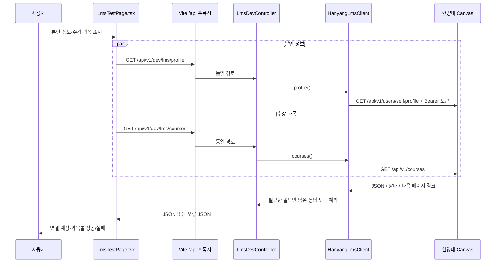

# LMS 테스트 페이지의 코드와 동작

## 목적과 범위

`backend/.env`에 본인 LMS 토큰을 설정했을 때 실제 과목·공지·과제·마감·학습 목록이 반환되는지
확인하는 읽기 전용 개발 도구다. 실제 토큰 테스트는 사용자가 수행해야 하며, 가상 API 테스트와 구분한다.
DB 저장·공지 AI 분석·번역·서비스 로그인은 이 검사 도구의 범위에 포함하지 않는다.

## 파일별 책임

| 파일 | 역할 |
| --- | --- |
| `backend/src/main/resources/application.yml` | 실행 디렉터리의 `.env`를 Spring 설정에 포함. `app.lms` 설정 연결 |
| `backend/src/main/java/com/aix/team03/integrations/lms/LmsProperties.java` | API 기본 주소와 토큰을 서버 메모리에서 관리 |
| `.../LmsDevController.java` | `/api/v1/dev/lms`의 HTTP GET 요청을 받고 클라이언트 호출. `prod`에서는 비활성 |
| `.../HanyangLmsClient.java` | Canvas HTTP 요청, 토큰 헤더, ID/응답 검증, 페이지네이션, 통신 오류 변환 |
| `.../LmsModels.java` | Course·CourseDetail·Announcement·Assignment·CourseModule·ModuleItem·Page 응답 타입 |
| `backend/src/main/java/com/aix/team03/global/error/GlobalExceptionHandler.java` | LMS 예외를 안전한 HTTP 상태와 오류 JSON으로 변환 |
| `frontend/vite.config.ts` | 브라우저의 `/api` 요청을 로컬 백엔드 8081로 프록시 |
| `frontend/src/shared/api/client.ts` | 공통 fetch, JSON·HTTP 오류 처리, code/upstreamStatus 보존 |
| `frontend/src/features/lms-test/api.ts` | 각 검사 API 경로와 TypeScript 응답 타입 |
| `frontend/src/features/lms-test/LmsTestPage.tsx` | 버튼·과목/기간 입력·결과·오류·날짜 표시 |
| `backend/src/test/java/com/aix/team03/integrations/lms/HanyangLmsClientTests.java` | 로컬 가상 Canvas로 요청·응답·실패 경로 검증 |

`.../`는 `backend/src/main/java/com/aix/team03/integrations/lms/`를 뜻한다.

## 전체 요청 흐름



토큰은 브라우저 → 백엔드 요청에 실리지 않는다. 백엔드가 LMS로 요청할 때만
`Authorization: Bearer ...`를 추가한다. `LmsProperties`를 API 응답으로 반환하지 않는다.

## 버튼 1: 본인 정보·수강 과목 조회

`loadCourses()`는 과목 상세 결과를 초기화하고 다음 두 호출을 동시에 기다린다.

```ts
const [owner, list] = await Promise.allSettled([
  getLmsProfile(),
  getLmsCourses(),
])
```

한 호출의 실패로 다른 성공 결과를 잃지 않도록 `Promise.allSettled`를 사용한다.
목록이 있으면 첫 과목을 기본 선택한다. 실제 과목 선택은 API에서 받은 ID로 한다.

## 버튼 2: 선택 과목 조회

`loadCourse()`가 선택 과목의 다음 네 리소스를 요청한다.

| 화면 영역 | 로컬 API (`/api/v1/dev/lms` 뒤) | Canvas API (`/api/v1` 뒤) | 주요 파라미터 |
| --- | --- | --- | --- |
| 과목 설명 | `/courses/{id}` | `/courses/{id}` | `include[]=syllabus_body` |
| 공지 | `/announcements` | `/announcements` | `context_codes[]=course_{id}`, 시작/종료일 |
| 과제 | `/courses/{id}/assignments` | `/courses/{id}/assignments` | `override_assignment_dates=true`, `order_by=due_at` |
| 주차 목록 | `/courses/{id}/modules` | `/courses/{id}/modules` | `per_page=50` |

여기도 `Promise.allSettled`를 사용한다. 과제 API가 403이더라도 공지가 성공했으면 그대로 보여준다.
결과가 돌아올 때까지 중복 조회와 입력 변경을 막는다.
다른 과목을 고르면 이전 결과를 지워 과목과 내용이 섞이지 않게 한다.
공지 기간을 바꾸면 이전 공지 결과를 지우며, 그 기간을 과제 기한 필터로 사용하지 않는다.

## 버튼 3: 학습 항목 조회

`loadItems(module)` → `getLmsModuleItems(courseId, moduleId)` → `moduleItems()` 순서다.
Canvas의 `/courses/{courseId}/modules/{moduleId}/items?include[]=content_details`를 요청한다.
모듈에 항목이 내장될 것이라고 가정하지 않고 별도 목록 API로 조회한다.
자료·페이지·과제·외부 도구 등의 제목과 종류를 표시하며 파일/동영상 본문은 가져오지 않는다.

## 외부 요청과 페이지네이션

`HanyangLmsClient.get()`는 토큰이 비었으면 외부 요청 전에 `LMS_NOT_CONFIGURED`를 반환한다.
HTTPS를 사용하며 로컬 가상 서버에만 HTTP를 허용한다. 연결 제한 10초, 읽기 제한 15초다.
리디렉션을 따라가지 않으며 오류 원문·인증 헤더를 브라우저로 전달하지 않는다.

목록 메서드는 공통 `pages()`를 사용한다.

```text
첫 URL 요청 → JSON 목록 추가 → Link 헤더의 rel="next" 확인
  → 동일 scheme/host/port/path인지 확인 → 다음 페이지 요청
  → 다음 링크가 없거나 5페이지에 도달하면 종료
```

반환 형식은 `{ items, pagesFetched, truncated }`다.
다른 주소/경로·반복된 다음 링크는 중단한다. 상한에 도달하면 `truncated=true`를 표시한다.
필수 ID·이름 등이 없거나 목록에 null이 섞여 있으면 정상 빈 목록으로 처리하지 않고 오류로 표시한다.

## 날짜·원문·오류를 표시하는 방식

- `due_at`: 마감, `unlock_at`: 제출 시작, `lock_at`: 제출 차단. 각각 보존한다.
- `override_assignment_dates=true`는 조회 계정에 적용되는 날짜를 요청한다. 개인/분반별 차이는 실환경에서 대조한다.
- `dateLabel()`은 한국 시간과 원본 문자열을 함께 표시한다. null·잘못된 날짜는 별도 문구로 남긴다.
- `posted_at`는 공지 게시 시각이다. 과제 마감으로 사용하지 않는다.
- HTML은 React의 `<pre>{value}</pre>`로 출력하므로 HTML/스크립트로 실행되지 않는다.
- `OriginalLink`는 파싱 가능한 HTTP/HTTPS 링크만 제공한다.
- 서버는 `{ code, message, upstreamStatus }`를 반환하고 `ApiError`가 이 정보를 보존한다.
- `settled()`와 `Panel`은 성공 데이터 또는 해당 영역의 오류를 표시한다. 오류를 빈 목록으로 바꾸지 않는다.

## 이 검사로 알 수 없는 것

가상 테스트 통과만으로 한양대 운영 서버의 토큰 발급·API 권한·LearningX 호환성을 증명하지 않는다.
일반 학교 Open API 키는 LMS 토큰과 별개다. 실제 계정으로 화면과 대조한 결과를 남겨야 연동 가능성을 확정할 수 있다.
확인 순서와 해석은 [검사 방법](lms-testing.md)과 [검증 기록](lms-verification.md)을 참고한다.

공식 근거: [Courses](https://developerdocs.instructure.com/services/canvas/resources/courses),
[Announcements](https://developerdocs.instructure.com/services/canvas/resources/announcements),
[Assignments](https://developerdocs.instructure.com/services/canvas/resources/assignments),
[Modules](https://developerdocs.instructure.com/services/canvas/resources/modules).
