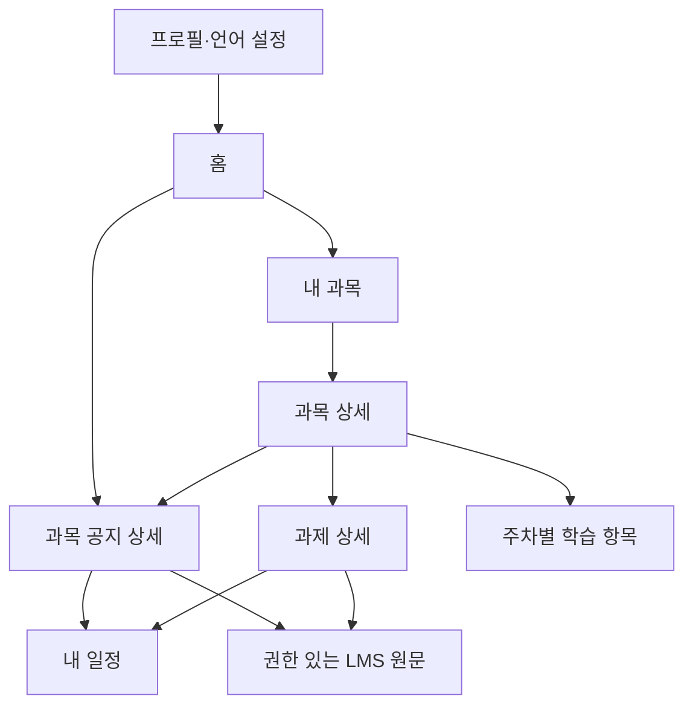

# NEST 와이어프레임 초안

작성: 2026-10-24. 화면 구성·정보 우선순위·전환을 논의하기 위한 제안이다.
예시의 과목·날짜·공지는 가상 데이터이며 실제 한양대 API 응답이 아니다.
제품 화면 구현 및 실환경 LMS 검증과 구분한다.

## 기본 방향

모바일 우선 반응형 웹. 기존 480px 폭의 앱 구조를 출발점으로 삼는다.
상단은 NEST·선호 언어, 하단은 `홈 / 과목 / 공지 / 내 일정 / 프로필`로 제안한다.
커뮤니티는 범위 확정 후 독립 메뉴 또는 홈 진입점으로 추가한다.
개발자용 `LMS 테스트`는 제품 하단 메뉴에서 분리하는 것을 최종 방향으로 삼되, 현재 앱의 검사 진입점은 유지한다.

## 화면별 초안

| 화면 | 주요 정보 | 핵심 동작 |
| --- | --- | --- |
| 홈 | 가까운 과제 마감, 나에게 해당하는 학교 공지, 확인 필요 공지, 마지막 갱신 | 과제/공지 상세 열기, 내 과목 진입 |
| 과목 목록 | 과목명·코드·연동 상태·갱신 시각 | 과목 선택, 재조회 |
| 과목 상세 | 과목명·설명, 공지/과제/학습 목록 탭 | 공지 열기, 과제 열기, 원본 학습 항목 열기 |
| 과제 상세 | 설명, 마감, 제출 차단 시각, 제출 방식, 과목, 출처 | 원문/쉬운 설명 전환, 일정 저장, LMS로 이동 |
| 공지 목록 | 학교/과목 출처, 해당/확인 필요, 마감 | 해당 이유와 할 일 확인 |
| 공지 상세 | 요약·해당 이유·마감·행동·서류·출처·확인 시각 | 원문 전환, 일정 저장 |
| 내 일정 | 저장한 공지/과제, 마감, 완료 상태 | 완료 표시, 원문 상세로 이동 |
| 프로필 | 선호 언어·국적·비자·과정·학년·거주 형태 | 필수 검증, 저장, LMS 연결 관리 |



## 정보 배치 예시

```text
┌──────────────────────────────┐
│ NEST                 English │
├──────────────────────────────┤
│ 지금 해야 할 일              │
│ [과제] AIX 프로젝트 제안서   >│
│ 10/27 23:59 · 한국 시간       │
│                              │
│ 나에게 필요한 학교 공지      │
│ [해당] 기숙사 입사 서류     > │
│ [확인 필요] 장학금 신청     > │
│                              │
│ 내 과목 보기               > │
├──────────────────────────────┤
│ 홈  과목  공지  내 일정  나   │
└──────────────────────────────┘
```

과목 상세는 `공지 / 과제 / 학습 목록`을 탭으로 전환한다.
공지 상세는 `나에게 해당하는 이유 → 해야 할 일 → 마감 → 서류·제출처 → 원문` 순서로 배치한다.
과제 상세는 `마감 → 과제 설명 → 제출 방식 → 제출 차단 → 원문` 순서로 배치한다.
원문과 AI 설명은 구분하고, AI 결과가 없으면 원문을 그대로 보여준다.

## 반드시 논의할 실패 상태

| 상태 | 표시와 행동 |
| --- | --- |
| LMS 미연결 | 연결 안내와 샘플 미리보기 구분. 가짜 실데이터를 보여주지 않음 |
| 토큰 만료/권한 없음 | 다시 연결 안내. 빈 목록으로 바꾸지 않음 |
| 일부 API 실패 | 성공한 공지/과제는 유지하고 실패 영역에 재시도 제공 |
| 조회 상한 도달 | 일부만 조회되었음을 표시. 전체 건수로 오인시키지 않음 |
| 빈 목록 | 선택 기간/과목 내 반환 항목 없음. 미지원으로 단정하지 않음 |
| 날짜 누락 | 날짜가 제공되지 않았다고 표시하고 원문 확인 안내 |
| 번역/분석 실패 | 원문과 실패 상태·재시도 제공 |
| 개인화 불확실 | 확인 필요로 노출하고 부족한 조건 안내 |
| 저장 중복 | 이미 저장됨 표시 |
| 프로필 누락 | 해당 입력란에 오류 표시하고 저장/생성 중단 |

## 첫 화면 검토에서 결정할 것

- 홈의 중심을 ‘해야 할 일’로 둘지 ‘맞춤 공지’로 둘지.
- 과목을 독립 하단 메뉴로 둘지 홈의 보조 진입점으로 둘지.
- 일정·커뮤니티를 첫 MVP와 최종 발표 중 어느 시점에 포함할지.
- 선호 언어 기본값과 언어별 검수 담당.

첫 사용성 확인은 유학생에게 화면의 마감과 해야 할 일을 설명하게 하고, 이해하지 못한 문구와 막힌 전환을 기록한다.
